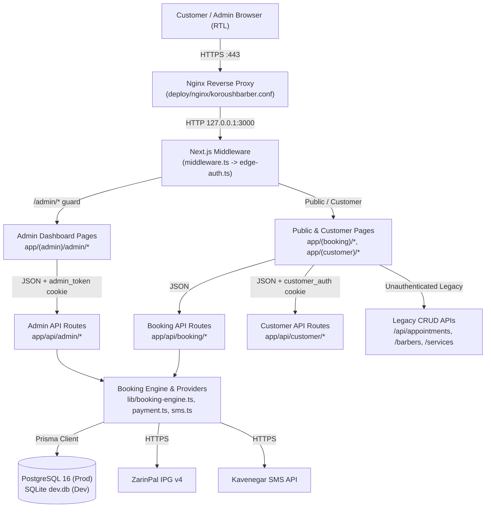
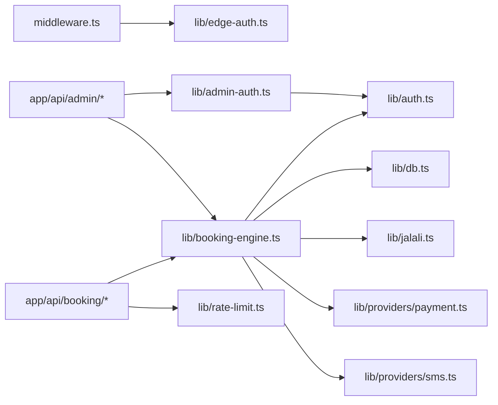
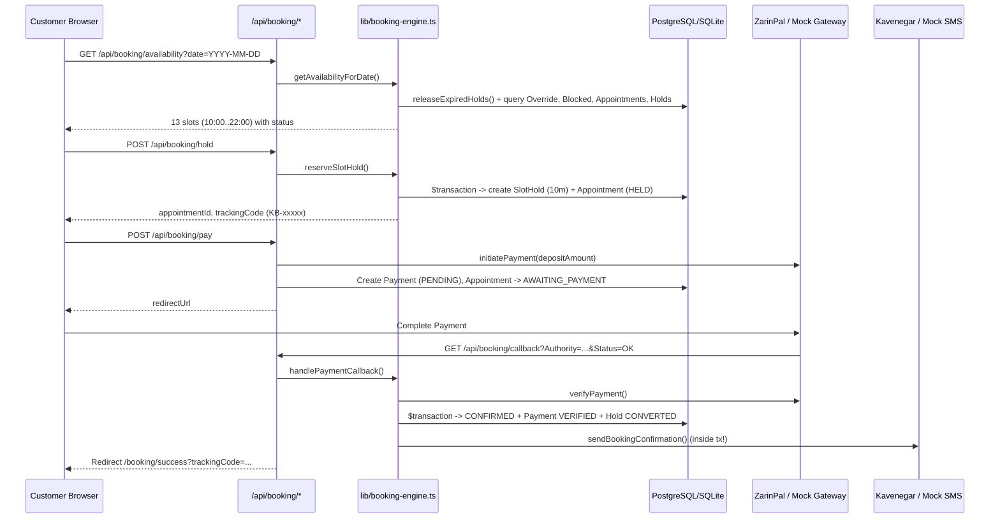
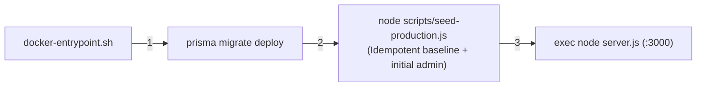
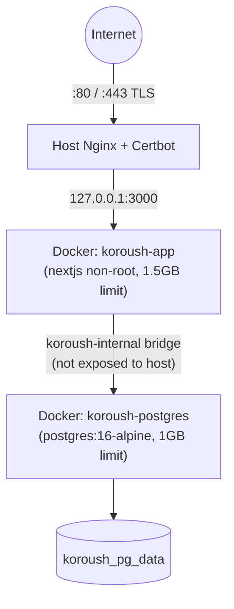

# 02 — Architecture Analysis

## 1. Overall System Architecture
Koroush Barber is a **monolithic Next.js 14 full-stack application** using the App Router with server-rendered/dynamic API route handlers backed by Prisma ORM.

## 2. Component Dependency Graph

## 3. End-to-End Booking & Payment Data Flow

## 4. Application Startup & Deployment Architecture

## 5. Architectural Findings
- **Inconsistent Auth Boundary:** `middleware.ts` only matches `/admin/:path*`, relying on route handlers for API auth. While `/api/admin/*` consistently calls `authorizeAdmin()`, legacy routes (`/api/appointments*`, `/api/barbers*`, `/api/services*`) have no auth at all (`SEC-002`), and `/api/customer/*` uses an unsigned ID cookie (`SEC-001`).
- **Domain Logic Leakage & Duplication:** Deposit calculation (`pay/route.ts` vs `booking-engine.ts`) and cancellation logic (`/api/booking/cancel` vs `/api/customer/appointments/[id]`) are duplicated with divergent business rules (`BUG-001`, `BUG-007`).
- **Transaction Boundary Violation:** `handlePaymentCallback()` runs an external HTTP SMS call inside `prisma.$transaction()` (`BUG-004`).
- **Single Points of Failure:** Single Node.js container (`127.0.0.1:3000`), single PostgreSQL instance, process-local `rateLimitStore` (`PERF-001`), and missing background worker for scheduled reminders/birthdays (`BUG-008`).
