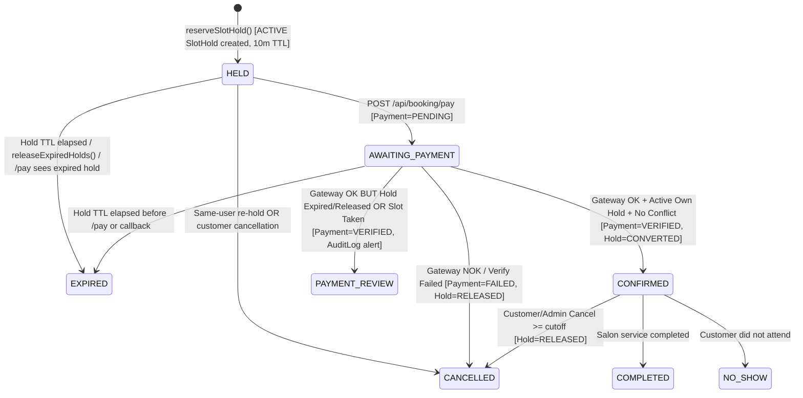
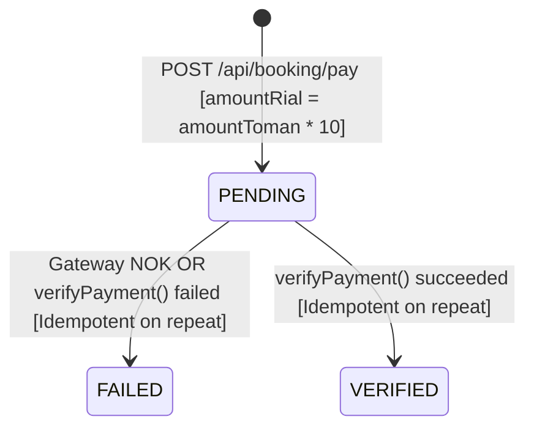

# Phase 3 — Booking & Payment State Machine

**Branch:** `fix/phase-3-payment-booking-integrity`  
**Scope:** Explicit state transitions across `SlotHold`, `Appointment`, and `Payment`

---

## 1. Appointment & Hold Lifecycle Diagram

---

## 2. Payment Lifecycle Diagram

---

## 3. Invariants Enforced in Code

1. A customer cannot pay for another customer's hold (`activeSlotHold.customerPhone !== appointment.customerPhone` -> HTTP `403`).
2. `POST /api/booking/pay` only accepts `HELD` or `AWAITING_PAYMENT` appointments with an unexpired `ACTIVE` `SlotHold`.
3. `handlePaymentCallback` never transitions an expired, released, or conflicting appointment to `CONFIRMED`; instead it records `Payment.status = VERIFIED`, moves `Appointment.status = PAYMENT_REVIEW`, and logs `PAYMENT_RECONCILIATION_ALERT`.
4. Duplicate callbacks (`VERIFIED` or `FAILED`) return idempotently (`isIdempotentRepeat: true`) without re-mutating state or sending duplicate SMS notifications.
