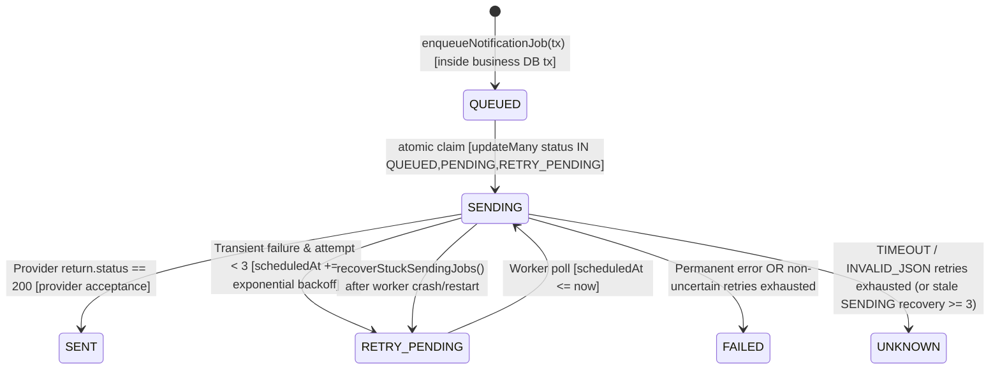

# Phase 4 — Transactional Outbox & Notification Architecture

**Branch:** `fix/phase-4-reliability-notifications`  
**Implementation:** [`lib/notifications.ts`](file:///c:/Users/blue/Documents/projects/barber/lib/notifications.ts), [`app/api/cron/notifications/route.ts`](file:///c:/Users/blue/Documents/projects/barber/app/api/cron/notifications/route.ts)

---

## 1. Architecture Overview (Database-Backed Transactional Outbox)

Rather than introducing Redis or RabbitMQ, Phase 4 uses the existing PostgreSQL/SQLite `NotificationJob` table as a durable transactional outbox:

---

## 2. Guarantees Delivered

1. **Atomic Enqueue with Business Event:** Business state changes (booking `CONFIRMED`, admin `RESCHEDULE`) and `NotificationJob` (`status: "QUEUED"`, `sentAt: null`) commit in the same `prisma.$transaction`. If the business transaction rolls back (e.g., 409 slot conflict), zero orphan `NotificationJob` rows are left behind.
2. **External HTTP Strictly Outside DB Transactions:** `processNotificationJob()` executes after `prisma.$transaction` commits; a failed/slow SMS never rolls back a confirmed appointment or committed reschedule (`BUG-002`, `BUG-004`).
3. **Duplicate Delivery Prevention:**
   - Enqueue deduplication (`dedupContains` checks active/sent jobs before creating).
   - Optimistic claim guard (`updateMany` transitioning `QUEUED | PENDING | RETRY_PENDING -> SENDING`) guarantees concurrent workers claim and dispatch strictly once.
4. **Scheduled Automation Worker (`BUG-008`):** `runScheduledNotificationCycle()` evaluates `sms_reminder_rules` (`appointmentReminder`, `birthdayGreeting`), enqueues due jobs idempotently, recovers any stranded `SENDING` jobs, and drains due outbox jobs—invocable via secured `POST /api/cron/notifications` (`CRON_SECRET` Bearer or admin session) or Admin SMS Center `PATCH` (`action: "process_outbox"` / `"run_automations"`).
5. **Graceful Drain:** Tracks active promises in `activeDeliveries` (`drainInFlightNotifications(timeoutMs)`), while worker restarts automatically recover any interrupted `SENDING` jobs via `recoverStuckSendingJobs()`.
